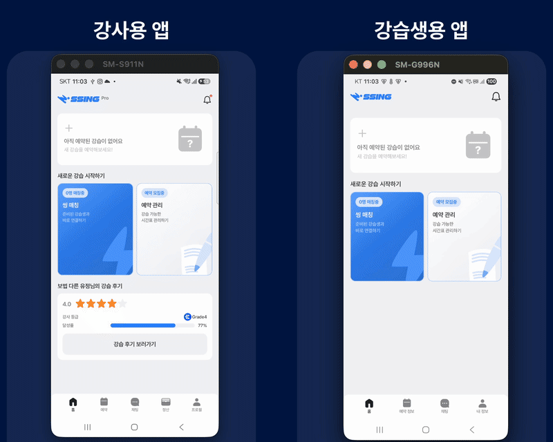
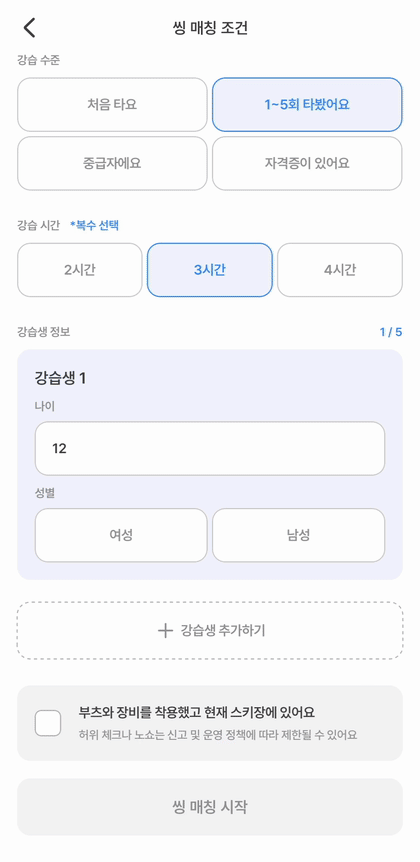
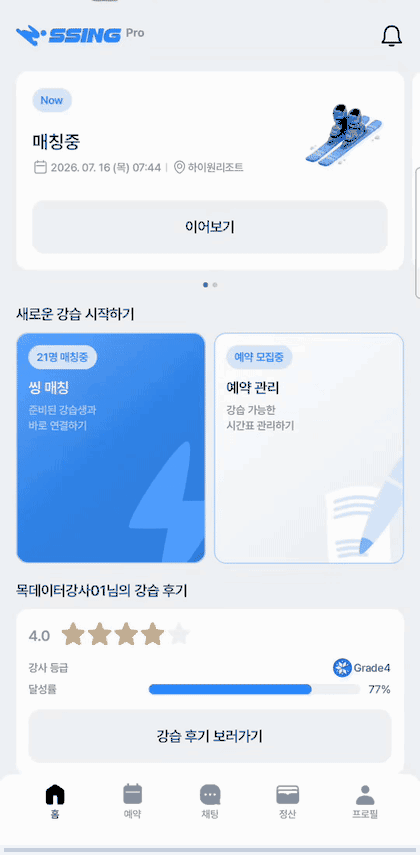
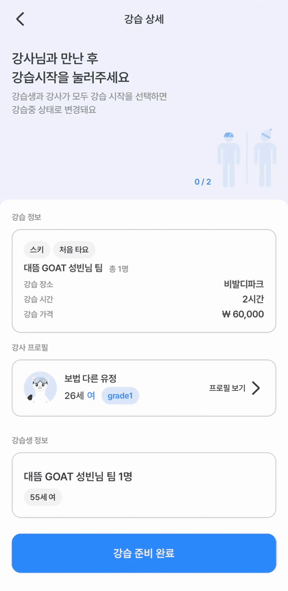
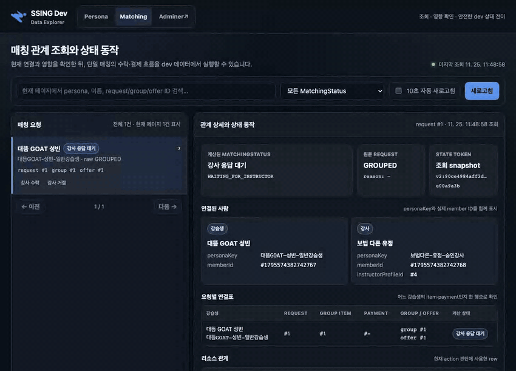
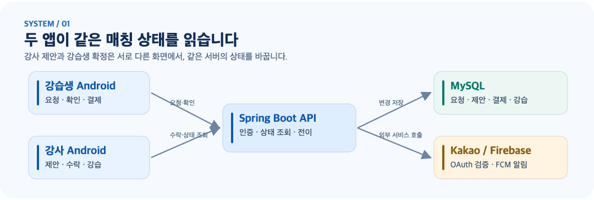
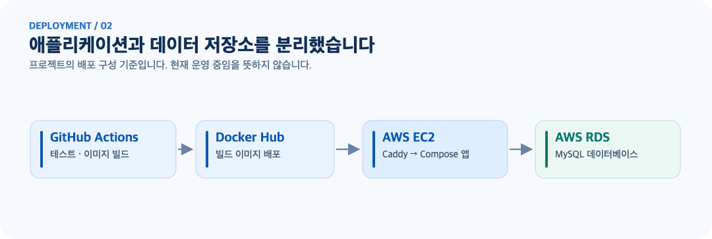

# SSING · 씽

스키장에서 강습을 받고 싶은 사람이 **지금 수업할 수 있는 강사**에게 연결되는 Android 서비스입니다. 강습생이 리조트와 종목, 수준, 강습 시간, 참가자를 고르면 강사가 제안을 받고, 양쪽의 수락과 결제 상태를 거쳐 강습이 확정됩니다.

**2026.06–07 · SOPT 38기 · 11인 팀(서버 2인) · 서버 개발 리드**

서버에서 Kakao 로그인과 토큰 정책, 매칭 상태 복구, 가격·참가자 응답, 개발용 검증 도구를 담당했습니다. 강습생·강사용 Android 앱은 팀의 공동 결과입니다.

[서버 저장소](https://github.com/TEAM-SSING/SSING-SERVER) · [Android 저장소](https://github.com/TEAM-SSING/SSING-ANDROID) · [SOPT 프로젝트 아카이브](https://www.sopt.org/project/291)

## 두 앱이 하나의 강습을 확정하기까지

왼쪽은 강사, 오른쪽은 강습생 앱입니다. 강습생이 조건을 제출하면 강사에게 제안이 도착합니다. 강사가 수락해도 바로 강습이 잡히지 않습니다. 강습생이 확인하고 결제 완료 상태까지 반영되어야 양쪽에서 확정된 강습을 볼 수 있습니다. 팀의 배포 당시 [발표용 원본 화면](https://github.com/TEAM-SSING/SSING-ANDROID/tree/7ba5f249ae7b05af048e42c3e5a79b7abe75c4bb#-screenshot)을 편집했습니다.

## 앱을 닫았다 열어도 진행 중인 요청으로 돌아갑니다

같은 강습을 다시 요청하는 대신 서버에서 진행 중인 요청을 찾아 해당 화면으로 돌려보냅니다. 매칭 탐색, 강사 응답 대기, 강습생 확인, 결제 대기처럼 끝나지 않은 단계에서는 기존 상태를 이어받습니다.

## 강사는 홈에서 현재 해야 할 일을 확인합니다

앱은 가격이나 홈 카드 문구로 상태를 추측하지 않습니다. 서버가 홈에 필요한 표시 상태와 다음 화면에 필요한 ID를 함께 내려줍니다. 홈 카드가 [실제 서버 API에 연결된 Android 화면](https://github.com/TEAM-SSING/SSING-ANDROID/pull/205)과 [서버 계약 변경](https://github.com/TEAM-SSING/SSING-SERVER/pull/148)을 분리해 확인할 수 있습니다.

## 확정된 강습은 상세에서 취소합니다

진행 중인 매칭 중단과 이미 확정된 강습 취소는 다릅니다. 강습 상세에서 취소 사유를 선택하고 확인하면 상세 화면에 취소 상태와 사유가 반영됩니다.

## 같은 흐름을 서버에서도 확인했습니다

팀 시연과는 별도로 로컬 서버와 MySQL을 실행해 단일 요청을 새로 만들었습니다. 원본 QA 콘솔에서 **강사 수락 → 강습생 수락 → 결제 완료**를 차례로 눌렀고, 세 상태 변경 요청의 성공과 최종 강습 확정을 확인했습니다. 결제는 이 로컬 QA 시드에서 강습 확정까지 확인하는 동작입니다.

## 시스템 구조

| 영역 | 구현 |
| --- | --- |
| 서버 | Java 21, Spring Boot 4, Spring Security, Spring Data JPA |
| 데이터 | MySQL 8.4, Flyway |
| 연동 | Kakao OAuth, JWT, REST, WebSocket, Firebase Cloud Messaging |
| 배포·관측 | GitHub Actions, Docker Hub, Docker Compose, EC2·RDS, Caddy, Sentry |

[시스템 원본](assets/readme/system.drawio) · [배포 원본](assets/readme/infra.drawio) · [매칭 흐름 원본](assets/readme/workflow.drawio)

## 두 앱의 매칭 상태를 일관되게 만드는 일

강습생과 강사가 다른 순서로 들어오고, 제안이 오는 사이 앱을 닫을 수도 있습니다. 그래도 요청은 중복되지 않아야 하고, 앱을 다시 열면 같은 제안과 금액으로 돌아와야 합니다. 이 프로젝트에서 가장 어려웠던 부분은 화면을 만드는 것보다, 그 화면이 어떤 서버 상태를 보여줘야 하는지 정하는 일이었습니다.

### 1. 먼저 기다리던 강습생이 다음 스케줄러까지 밀리는 문제

강사가 먼저 매칭을 켜 둔 경우에는 강습생이 요청하는 순간 후보를 찾을 수 있었습니다. 반대로 강습생이 먼저 요청하고 강사가 나중에 노출을 켜면, 노출 API는 성공했는데 커밋 직후 실행된 탐색의 결과가 저장되지 않아 다음 1분 주기까지 기다리는 문제가 있었습니다. 노출 저장 성공과 매칭 제안 생성 성공은 서로 다른 일이었습니다.

저장 순서를 분명히 했습니다. **강사 노출을 커밋 → 대기 요청을 조회 → 요청 한 건씩 새 트랜잭션에서 잠그고 탐색 → 그룹·제안·가격 스냅샷을 함께 저장 → 커밋 후 알림 전달.** 새 트랜잭션을 여는 책임을 트리거가 아닌 실제 쓰기를 담당하는 `MatchingSearchService.search()`에 두었습니다. 즉시 탐색과 주기 재탐색이 같은 입구를 이용하고, 한 요청에서 실패해도 앞서 처리된 요청까지 되돌리지 않습니다.

같은 요청을 두 경로가 잡았을 때는 아직 `REQUESTED`인 행을 DB에서 잠그고 나서 처리합니다. 먼저 처리한 쪽이 상태를 바꾸면, 나중에 진입한 쪽은 같은 그룹과 제안을 다시 만들지 않습니다. 당시 통합 테스트는 스케줄러를 끈 상태에서 **강사 노출 → 제안 생성 → WebSocket 수신 → 같은 제안의 REST 조회**를 확인했고, 같은 요청의 탐색을 두 번 동시에 실행해 중복 생성도 검증했습니다. [즉시 매칭 복구 PR #188](https://github.com/TEAM-SSING/SSING-SERVER/pull/188)

### 2. 소켓을 놓쳐도 같은 제안과 강습으로 돌아가는 방법

강사가 수락한 뒤에도 강습생 확인과 결제가 남아 있습니다. 이 사이 앱을 종료하면 마지막 화면이나 수신한 소켓 메시지만으로 현재 상태를 알 수 없습니다. 그래서 WebSocket은 변경을 빠르게 알려주는 데 쓰고, 재진입할 때는 REST로 현재 상태를 다시 확인하도록 역할을 나눴습니다.

강사 홈은 **열 화면을 고르는 `displayStatus`, 제안 흐름을 잇는 `offerId`, 확정된 강습 상세를 조회하는 `lessonId`**를 구분합니다. 확정 전에는 강습 ID가 없고, 확정 후에는 현재 강습 ID와 그 강습을 만든 제안 ID가 둘 다 있습니다. ID가 있는지만 보고 화면을 고르거나 가장 최근 제안을 가져오면, 여러 강습이 있을 때 다른 요청의 카드와 상세를 연결할 수 있습니다. 강습이 참조하는 원본 제안에서 ID를 읽고, 카드를 열 때 서버 상태를 재조회하도록 계약을 맞췄습니다. [강사 홈의 ID 계약 PR #148](https://github.com/TEAM-SSING/SSING-SERVER/pull/148) · [강습생 재진입 응답 PR #165](https://github.com/TEAM-SSING/SSING-SERVER/pull/165)

### 3. 다시 들어와도 금액과 참가자가 달라지지 않도록

강사가 설정하는 요금은 120분 기준입니다. 제안할 때 기본 요금에 추가 인원 요금을 더하고 120·180·240분 중 실제 강습시간으로 환산해 원 단위로 반올림합니다. 예를 들어 기본 6만 원, 추가 1인 2만 원인 2인 180분 강습이면 강습료는 12만 원입니다. 리조트 패찰비는 **강습생 총액에만 한 번** 더하고 강사 정산액에는 넣지 않습니다. 앱마다 같은 숫자 하나를 내려주면 결제액인지 정산액인지 구분할 수 없기 때문에 역할별 응답에서 금액의 의미를 분리했습니다.

가격표는 바뀔 수 있지만 이미 보낸 제안은 바뀌면 안 됩니다. 제안이 만들어질 때 계산값을 스냅샷으로 저장해 결제 대기·확정·취소 뒤에도 같은 금액을 읽도록 했습니다. 참가자도 같은 원칙으로 **신청 계정과 해당 요청의 실제 참가자**를 나눴습니다. 보호자가 두 사람 몫을 신청하면 보호자 닉네임은 신청자이고 인원수는 요청에 저장된 참가자 기준입니다. 이름은 선택 필드와 nullable 컬럼으로 추가해 기존 신청과 구버전 앱의 요청도 유지했습니다. [가격 계산과 복구 PR #185](https://github.com/TEAM-SSING/SSING-SERVER/pull/185) · [참가자 응답과 마이그레이션 PR #193](https://github.com/TEAM-SSING/SSING-SERVER/pull/193)

### 4. 재현용 데이터와 실제로 바뀌는 상태를 분리했습니다

DB에서 상태값만 결제 완료로 바꾸면 화면은 그럴듯해도 강습 생성과 참가자 연결이 같이 검증되지 않습니다. 반대로 두 앱을 매번 나란히 열어 같은 상태까지 만들면 문제가 난 단계로 돌아가는 데 오래 걸립니다. 그래서 초기 시드는 테스트 계정과 기본 강사 설정까지만 만들고, 강사 선대기나 후보 없음 같은 조건은 시나리오별로 붙였습니다. 이후 단계는 QA 콘솔에서 **서비스의 기존 강사 수락·강습생 수락·결제 완료 경로**를 호출합니다.

공유 개발 환경에서는 두 사람이 같은 화면을 보고 작업할 수 있습니다. 콘솔은 누가 어떤 요청을 바꾸는지 먼저 보여주고, 실행할 때 기존 화면의 상태와 서버 상태를 다시 비교해 달라졌으면 `409`로 재조회를 유도합니다. 강사 설정은 관련 행을 잠근 뒤 같은 트랜잭션에서 검증하고 저장합니다. 반면 영향이 넓은 매칭 거절은 콘솔에서 바로 실행시키지 않고 미리보기만 제공했습니다. [초기 데이터와 시나리오 분리 PR #190](https://github.com/TEAM-SSING/SSING-SERVER/pull/190) · [영향 미리보기 PR #196](https://github.com/TEAM-SSING/SSING-SERVER/pull/196) · [QA 콘솔의 상태 변경 PR #197](https://github.com/TEAM-SSING/SSING-SERVER/pull/197)

[설계와 기여 근거 더 보기](docs/technical-notes.md) · [시연 출처·로컬 재현](docs/demo-verification.md)
