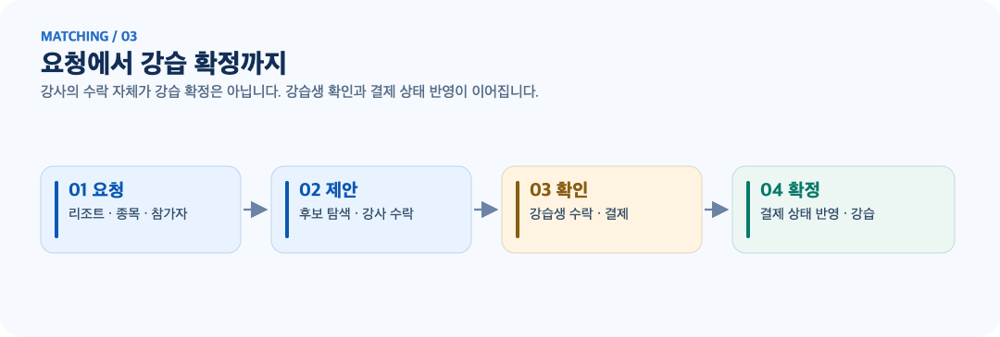

# SSING 시연 출처와 검증

- **Native Android:** 원본은 팀 Android 저장소의 `7ba5f249` README에 게시된 실제 발표/시연 3편과 팀의 [Android PR #205](https://github.com/TEAM-SSING/SSING-ANDROID/pull/205) 영상입니다. 발표 배경의 데스크톱 도구를 프레임 밖으로 자르고, 재진입 영상에서 무관한 앱 화면을 잘랐습니다. Android APK를 새로 빌드·실행한 영상이 아닙니다.
- **서버 QA:** 서버 `b657378`로 새 MySQL 컨테이너와 Spring 프로세스를 localhost에서만 실행했습니다. repository의 Flyway SQL, base 시드와 `matching-price-vivaldi` scenario로 시작 조건을 만든 뒤, API로 강습생의 요청 한 건을 새로 생성했습니다. 콘솔에서 강사 수락, 강습생 수락, 결제 완료를 실행하여 POST 세 건이 모두 성공하고 최종 상태가 확정으로 바뀌는 것을 확인했습니다.
- **구분:** 네이티브 시연과 서버 QA는 다른 세션입니다. 역사적 Android 시연의 가격과 로컬 QA fixture 가격은 같지 않습니다. 실제 카드 결제, 실사용 계정, 프로덕션·공용 개발 DB는 사용하지 않았습니다.

서버 로컬 QA를 재현할 땐 저장소의 [테스트 시드 가이드](https://github.com/TEAM-SSING/SSING-SERVER/blob/b657378/docs/database-seed.md)와 [개발 도구 설명](https://github.com/TEAM-SSING/SSING-SERVER/blob/b657378/docs/dev-data-explorer.md)을 참고하세요. 테스트 페르소나에서 요청을 만들고 매칭 관계 화면에서 해당 요청의 영향을 확인할 수 있습니다.

